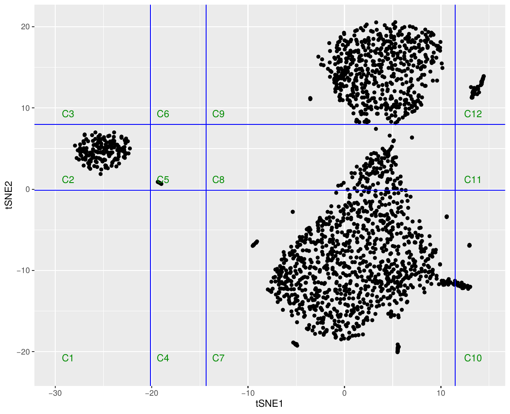

# tsne-gene-partition

Split a gene-level tSNE embedding into regions using density troughs, then export each region's genes as a table ready for pathway analysis (IPA).

The embedding here comes from a [LinSeed](https://github.com/ctlab/LinSeed) deconvolution of bulk whole-blood RNA-seq. LinSeed places genes in a 2-D tSNE space and assigns its top marker genes to each inferred cell-type component. The genes form several well-separated islands. The question this code answers is simple: **which genes sit in which island, and what pathways do those islands represent?**

Two scripts handle the two halves of that question:

| Script | What it does |
|---|---|
| `partition_tsne_by_density.R` | Finds natural cut points along each tSNE axis, divides the plot into a grid of regions, and writes one differential-expression table per region for IPA upload. |
| `annotate_tsne_with_panglaodb.R` | Cross-references genes in hand-picked tSNE regions against PanglaoDB blood cell-type markers to check how well the LinSeed components line up with known cell types. |



---

## How the partitioning works

Drawing cluster boundaries by hand on a tSNE plot is subjective and hard to reproduce. Instead, the script uses the gaps that are already in the data.

1. **Estimate density along each axis.** `density()` (Gaussian kernel, default bandwidth) is applied separately to `tSNE1` and `tSNE2`.
2. **Find the troughs.** A local minimum is wherever the slope of the density curve changes sign from negative to positive:
   ```r
   troughs <- d$x[which(diff(sign(diff(d$y))) > 0) + 1]
   ```
   These are the empty stretches between islands, which makes them reasonable places to cut.
3. **Build the grid.** The troughs, padded with the axis minimum and maximum (±2), become vertical and horizontal break lines. With *m* troughs on tSNE1 and *n* on tSNE2, this gives *(m+1) × (n+1)* rectangular regions.
4. **Assign genes and export.** Genes are binned into regions by their coordinates. For each region, the matching rows of the full differential-expression table are written to their own CSV.
5. **Draw a guide plot.** A PDF shows the points, the break lines, and region labels (`C1`, `C2`, ...) so each output file can be traced back to its location on the plot.

Regions are numbered column by column: bottom to top along tSNE2, then moving right along tSNE1. Regions that fall in empty space still get a file, but it contains only the header row. This keeps the numbering consistent with the guide plot.

## Marker cross-check against PanglaoDB

`annotate_tsne_with_panglaodb.R` is a sanity check on what the islands represent biologically.

- It pulls human markers for 11 blood and immune cell types from PanglaoDB: T, B, and NK cells, monocytes, neutrophils, basophils, eosinophils, dendritic cells, macrophages, platelets, and erythroid cells.
- It defines three rectangular regions on the tSNE (lymphoid, granulocyte, erythroid) and tabulates which PanglaoDB cell types are most represented among the genes in each one.
- It flags genes that are **both** a LinSeed component marker **and** a PanglaoDB marker for the expected cell type (`Both.pDB.Linseed`).
- It plots the embedding colored by LinSeed component, with the PanglaoDB-matched genes enlarged and labeled (`CellType.SYMBOL`).

## Inputs

**tSNE coordinates** (CSV, one row per gene)

| column | description |
|---|---|
| *(row name / `X`)* | Ensembl gene ID |
| `tSNE1`, `tSNE2` | embedding coordinates |
| `marker` | LinSeed component the gene marks, or `NA` if it is not a top marker |

**Differential-expression table** (CSV). This can be any gene-level results table, as long as column `X` holds the same gene IDs used in the tSNE file. All of its columns (fold changes, p-values, FDRs, etc.) are carried through to the per-region output, so the files can be uploaded to IPA directly.

**PanglaoDB markers** (TSV). Only needed for the annotation script. Download it from [panglaodb.se](https://panglaodb.se/markers.html); the version used here is `PanglaoDB_markers_27_Mar_2020.tsv`.

**Gene annotation** (CSV). The annotation script also needs a gene ID-to-symbol table (`PROBEID`, `SYMBOL`) to attach gene symbols to the tSNE rows.

## Usage

Requires R (≥ 4.0) and `ggplot2`.

Set the input and output paths at the top of each script, then run:

```bash
Rscript partition_tsne_by_density.R
```

The annotation script is meant to be stepped through in an interactive R session, because most of it prints cross-tabulations to inspect along the way. Run non-interactively, it still writes the annotated CSV and the plot:

```r
source("annotate_tsne_with_panglaodb.R", echo = TRUE)
```

## Outputs

| File | From |
|---|---|
| `tables_for_IPA/cluster_<i>.csv` | Partition script. DE results for genes in region *i*. |
| `tables_for_IPA/cluster_guidance.pdf` | Partition script. Plot with break lines and region labels. |
| `tsne_annotated_panglaodb.csv` | Annotation script. tSNE table with `SYMBOL`, `pDB` cell-type tag, and `Both.pDB.Linseed` flag. |
| `tSNE_celltype_vs_panglaodb.pdf` | Annotation script. Labeled embedding. |

The per-region CSVs are uploaded to IPA separately for Core Analysis; pathway enrichment is not run inside this repo.

## Caveats

- Troughs are found **one axis at a time**, so the regions are always axis-aligned rectangles. This works well when islands are separated along the axes. If two islands overlap in projection on both axes, they will end up in the same region.
- The number of troughs depends on the kernel bandwidth. If a single island gets split, or two islands get merged, it is worth checking `density(..., adjust = )`.
- tSNE layouts are stochastic. Coordinates from a different run, or a different `k`, will give different break points, so always check the guide plot before interpreting region numbers.
- The regions in the PanglaoDB script are set by hand for one specific embedding and will need to be redrawn for a new one.

## References

- Zaitsev K, Bambouskova M, Swain A, Artyomov MN. *Complete deconvolution of cellular mixtures based on linearity of transcriptional signatures.* Nat Commun 10, 2209 (2019). [LinSeed](https://github.com/ctlab/LinSeed)
- Franzén O, Gan LM, Björkegren JLM. *PanglaoDB: a web server for exploration of mouse and human single-cell RNA sequencing data.* Database (2019).
